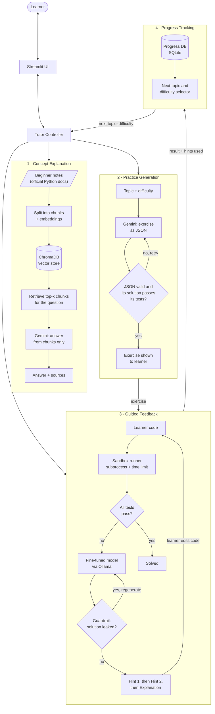
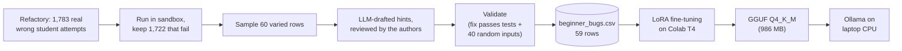

# Beginner Python Tutor

A Generative AI-based learning system for beginners in programming.

*7th-semester Generative AI course project, Dept. of ISE, M S Ramaiah Institute of Technology (MSRIT).*

- **Team:** Aryan Raj, Ambrin RK
- **Guide:** Dr. Evangeline D.

The app helps a beginner fix their own Python code without handing them the answer.
- It **runs the learner's code safely** against test cases.
- It passes the real error to a **small language model that we fine-tuned** to give step-by-step hints instead of solutions.
- A **guardrail** blocks any reply that gives the solution away.

Around this core, the app can also explain concepts from the official Python docs (RAG), generate new checked exercises, and track each learner's progress to suggest what to practise next.

> **Everything except Gemini runs on an ordinary laptop** (Windows 11, 16 GB RAM, no GPU). The fine-tuned model runs on the CPU through Ollama.

---

## The four modes

| Mode | What the learner does | How it works |
|---|---|---|
| 🛠️ **Guided Feedback** | Writes code for a problem and runs it; asks for Hint 1, then Hint 2, then the Explanation | Sandbox (subprocess + 5 s limit + safety checks) → **fine-tuned Qwen2.5-Coder-1.5B (LoRA)** via Ollama → rule-based guardrail |
| 📖 **Concept Explanation** | Asks a question such as "What does range(5) give me?" | **RAG:** 129 chunks of the official Python docs in **ChromaDB** → Gemini answers *only* from the retrieved chunks and cites them |
| ✨ **Practice Generation** | Gets a new exercise for a topic and level | Gemini writes an MBPP-style exercise as **JSON**. It is shown only if the JSON is valid, the tests are safe, and the hidden solution **passes all its own tests** |
| 📈 **My Progress** | Sees mastery per topic and what to do next | **SQLite** stores every run, hint and result. Mastery update: m ← m + 0.3 (credit − m). A rule picks the next topic and difficulty |

## Architecture



How the tutor model was built (offline):



The full diagrams, three algorithms and the design decisions are in [`methodology/`](methodology/).

## Key facts

| | |
|---|---|
| **Dataset** | 59 real buggy attempts by NUS students (from Refactory [Hu et al., ASE 2019]), 5 problems, 5 topics. Runtime 31, logic 28. See [`dataset/README.md`](dataset/README.md) |
| **Model** | Qwen2.5-Coder-1.5B-Instruct + LoRA (r = 8, α = 16). 9.2 M trainable parameters (0.59%). 3 epochs on a free T4 (0.8 min) |
| **Split** | train 40 / validation 7 / test 12 (stratified, seed 42), plus 5-fold cross-validation |
| **Training result** | Validation loss 1.845 → 1.535 with no overfitting. 5-fold CV validation loss 1.486 ± 0.088 |
| **Reply format** | `Bug type / Hint 1 / Hint 2 / Explanation`. The same prompt is used in training and in the app ([`training/prompt_format.py`](training/prompt_format.py)) |
| **On the laptop** | About 10–17 s per hint on the CPU (Intel Iris Xe laptop, 16 GB RAM) |
| **Gemini** | `gemini-3.5-flash`, falling back to `gemini-3.5-flash-lite` when it is busy |

---

## Setup on Windows 11

### What you need
1. **Python 3.14** from [python.org](https://www.python.org/downloads/). Tested with 3.14.5.
2. **Ollama** from [ollama.com/download/windows](https://ollama.com/download/windows). Tested with 0.34.0.
3. **A free Gemini API key** from [aistudio.google.com/apikey](https://aistudio.google.com/apikey).
4. **The fine-tuned model file `beginner-tutor-Q4_K_M.gguf` (986 MB).** It is too big for GitHub. Either ask the authors for it, or make it yourself by running [`training/train_tutor.ipynb`](training/train_tutor.ipynb) on Google Colab (see [`training/TRAINING_GUIDE.md`](training/TRAINING_GUIDE.md)).

### Steps
Open PowerShell in the project folder, then:

```powershell
# 1. Create the project's own Python environment and install the packages
python -m venv .venv
.\.venv\Scripts\python.exe -m pip install -r requirements.txt

# 2. Add your Gemini key: copy the example file, then edit .env and fill in GEMINI_API_KEY=...
copy .env.example .env

# 3. Put the model file in .\model\ together with the Modelfile, then create the Ollama model
mkdir model
copy training\Modelfile model\
#    (copy beginner-tutor-Q4_K_M.gguf into .\model\ as well)
cd model
ollama create beginner-tutor -f Modelfile
cd ..

# 4. Start the app (it opens http://localhost:8501)
.\.venv\Scripts\python.exe -m streamlit run app\app.py
```

- **System check:** the sidebar's **System check** should say *all OK ✅*.
- **First start:** the first visit to Concept Explanation downloads ChromaDB's small embedding model (80 MB) once.

### If something is wrong
| Problem | Fix |
|---|---|
| "Ollama is not running" | Start the Ollama app from the Start menu, then refresh the page |
| "Ollama is running but has no model 'beginner-tutor'" | Do step 3 again; `ollama list` must show `beginner-tutor` |
| "No Gemini key yet" | The file must be named exactly `.env` (not `.env.txt`), with `GEMINI_API_KEY=...` and no quotes. Restart the app |
| "Gemini is busy or unreachable" | Google's free tier is overloaded or out of quota. The app already retried and tried the fallback model, so wait a minute |
| First hint is slow | The model is loading. The app loads it in the background at start-up; later hints are faster |

---

## A 5-minute demo
1. **Guided Feedback → Try it yourself → Sequential search.** Write `if x < seq[i]:` instead of `<=`, then press **Ctrl+Enter**.
   - The result is 9 of 11 tests passed.
   - Click **💡 Get a hint**, then **Show Hint 2**. No line of the solution appears.
   - Fix the code. It says *Help used: Hint 2* and *Progress saved*.
2. **Examples from real students:** pick a test row the model never saw during training, and compare the model's hints with our dataset answer.
3. **Concept Explanation:**
   - Click *"What does an IndexError mean?"*, then open **Sources**.
   - Ask *"How do I build a website with Django?"*. It refuses, because the notes don't cover it.
4. **Practice Generation:** click **✨ New exercise**. The grey line says its hidden solution passes all its tests.
5. **My Progress:** mastery bars, recent exercises, and **Practise it →** for the suggested next topic.

---

## What is in this repository

| Folder or file | In plain words |
|---|---|
| `app/app.py` | The web page (Streamlit). It is the only file you run |
| `app/config.py` | Every setting in one place: model names, the 5 s time limit, hint credits, mastery rate, difficulty bands |
| `app/tutor/sandbox.py` | Runs learner code safely: size limit, a structure check (`ast`), a separate process with a clean environment, and a 5 s timeout |
| `app/tutor/ollama_client.py` | Talks to the fine-tuned model in Ollama, using the exact training prompt |
| `app/tutor/guardrail.py` | Blocks replies with code blocks, `def`, a line of the solution, or a missing part; holds the safe template hint |
| `app/tutor/feedback.py` | Guided Feedback: model → guardrail → retry → template |
| `app/tutor/gemini_client.py` | Calls Gemini with retries and a fallback model |
| `app/tutor/rag.py` | Notes → chunks → ChromaDB → Gemini answers with sources |
| `app/tutor/build_notes.py` | Downloads the 5 official Python doc pages used as notes |
| `app/tutor/practice.py` | Gemini exercise generation and its 3 checks |
| `app/tutor/progress.py` | SQLite progress tracking and the next-topic rule |
| `app/tutor/examples.py` | Loads the course problems and the 12 test rows |
| `app/notes/` | The notes (official Python docs, PSF License; see `NOTICE.md`) |
| `dataset/` | Building the CSV: `scripts/` (runner, selection, validation, stats), `beginner_bugs.csv`, `README.md` |
| `training/` | The Colab notebook, `prompt_format.py` (the one prompt definition), `splits.py`, `Modelfile`, the training guide |
| `training_outputs/` | Real results from our Colab run: loss curve, settings table, base vs fine-tuned outputs, cross-validation, LoRA adapter |
| `methodology/` | Architecture diagrams (Mermaid), Algorithms 1–3 (LaTeX), design decisions |
| `requirements.txt` | Exact package versions |
| `.env.example` | The settings file, without the key |

**Not in the repository** (listed in `.gitignore`):
- `.env` (your key)
- `.venv/`
- `model/*.gguf` (986 MB)
- `training_outputs/merged_16bit/` (3 GB)
- `app/data/` (the learner database and the ChromaDB index, created at run time)

## Rebuilding things
Run these from the project folder. The scripts in `dataset/scripts` are run **without** `-I`, because they import `runner.py` from their own folder.

```powershell
# Dataset (from the raw Refactory files)
cd dataset\scripts
..\..\.venv\Scripts\python.exe build_candidates.py
..\..\.venv\Scripts\python.exe select_rows.py
..\..\.venv\Scripts\python.exe merge_labels.py
..\..\.venv\Scripts\python.exe validate_dataset.py
..\..\.venv\Scripts\python.exe dataset_stats.py
cd ..\..

# Notes for Concept Explanation (ChromaDB re-indexes by itself when they change)
cd app
..\.venv\Scripts\python.exe -m tutor.build_notes

# Quick self-tests
..\.venv\Scripts\python.exe -m tutor.sandbox
..\.venv\Scripts\python.exe -m tutor.progress
cd ..
```

## Honest limitations
- **Small dataset.** 59 rows from 5 problems, with no syntax errors (the source removed them). The model mainly learns the **hint style**: the format, and hints instead of answers. It does not learn new programming knowledge, and its details are sometimes wrong (for example, the wrong line number).
- **Labels drafted with an LLM.** The hints in the dataset were drafted with an LLM, then reviewed and corrected by the authors.
- **Not a full security sandbox.** It is enough for a supervised student project. It is not safe for untrusted strangers, and Windows has no simple per-process memory cap.
- **Rule-based mastery.** The progress rule is a simple moving average, not trained knowledge tracing.
- **Gemini dependence.** Concept Explanation and Practice Generation need Gemini, which needs internet and is subject to free-tier limits.

## Credits and licences
| Used | Licence |
|---|---|
| Refactory dataset: Y. Hu, U. Z. Ahmed, S. Mechtaev, B. Leong, A. Roychoudhury, "Re-factoring based program repair applied to programming assignments," ASE 2019, doi:10.1109/ASE.2019.00044 | LGPL-3.0 (in `dataset/raw/refactory/LICENSE`) |
| Qwen2.5-Coder-1.5B-Instruct (Alibaba Qwen team) | Apache-2.0 |
| Python 3.13 documentation (Tutorial and Sorting HOWTO), © 2001-2024 Python Software Foundation | PSF License v2 |
| MBPP (Austin et al., 2021), used as a style example | CC-BY-4.0 |
| Unsloth, Hugging Face Transformers, Ollama, ChromaDB, Streamlit, streamlit-code-editor, Google Gen AI SDK | Their own open-source licences |
